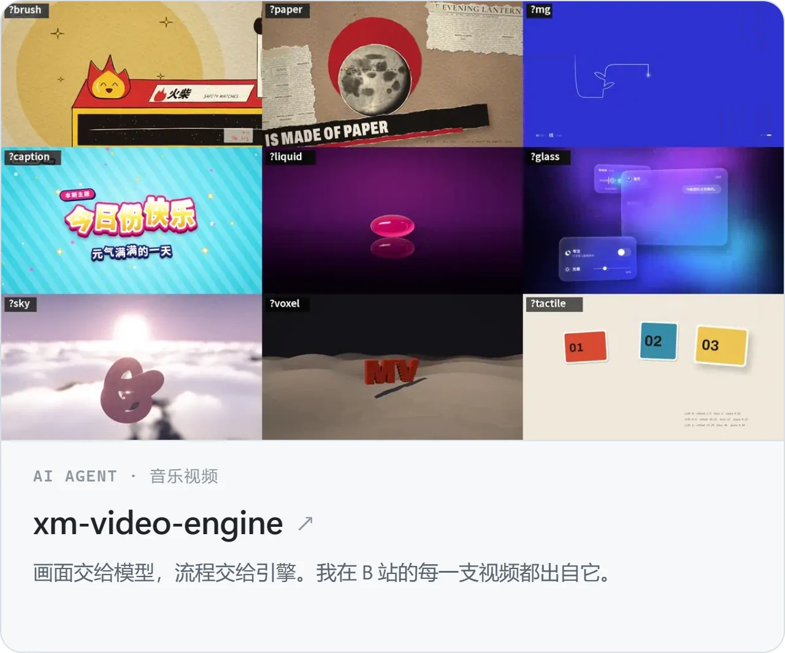
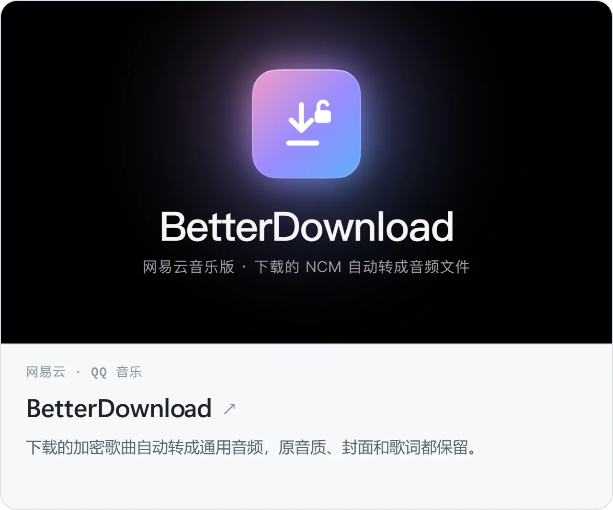
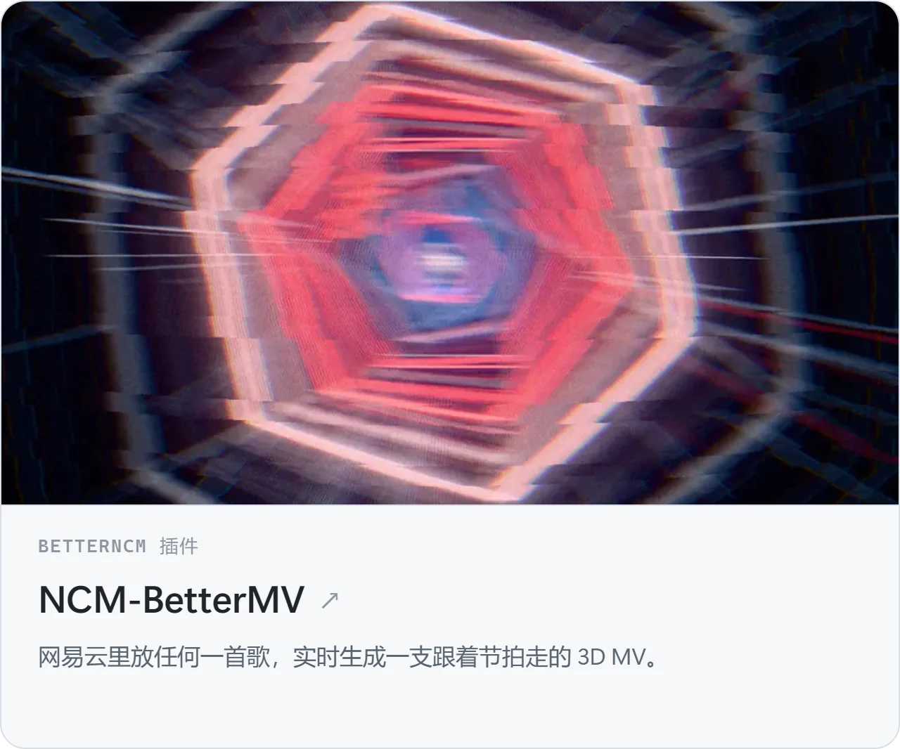
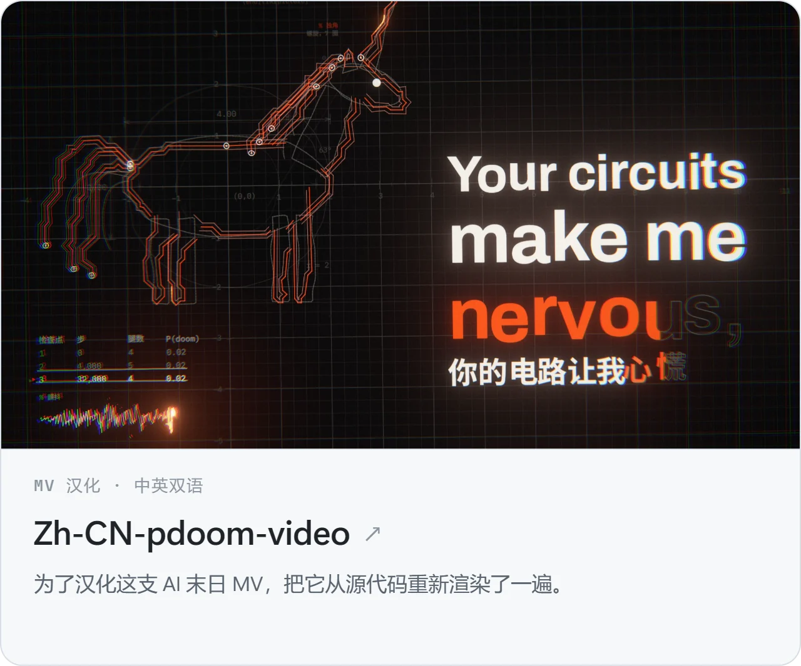
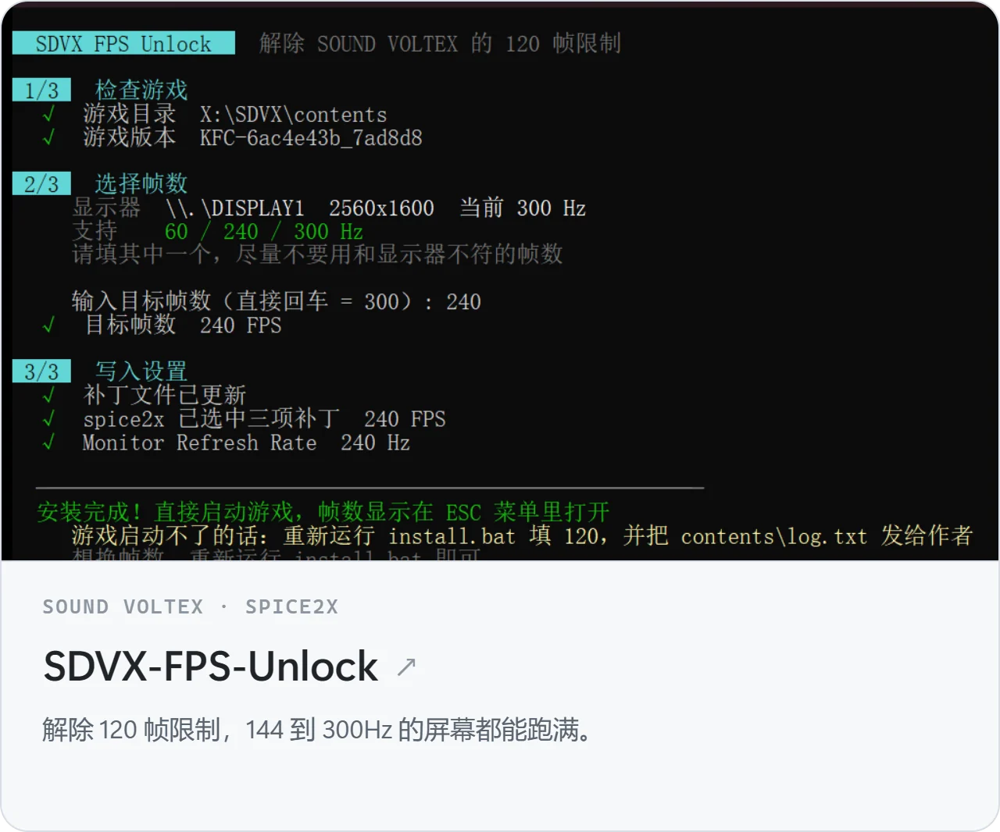
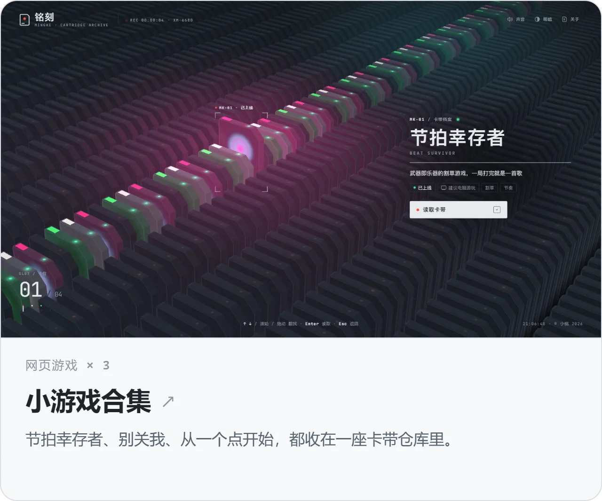
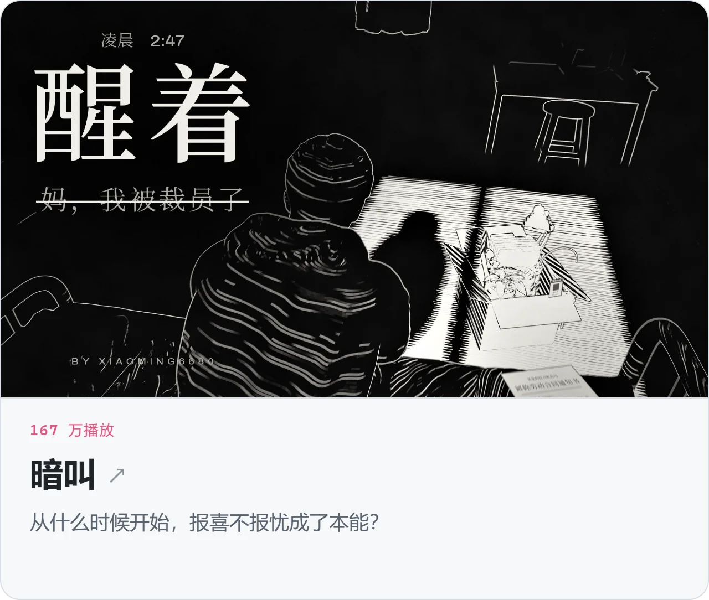
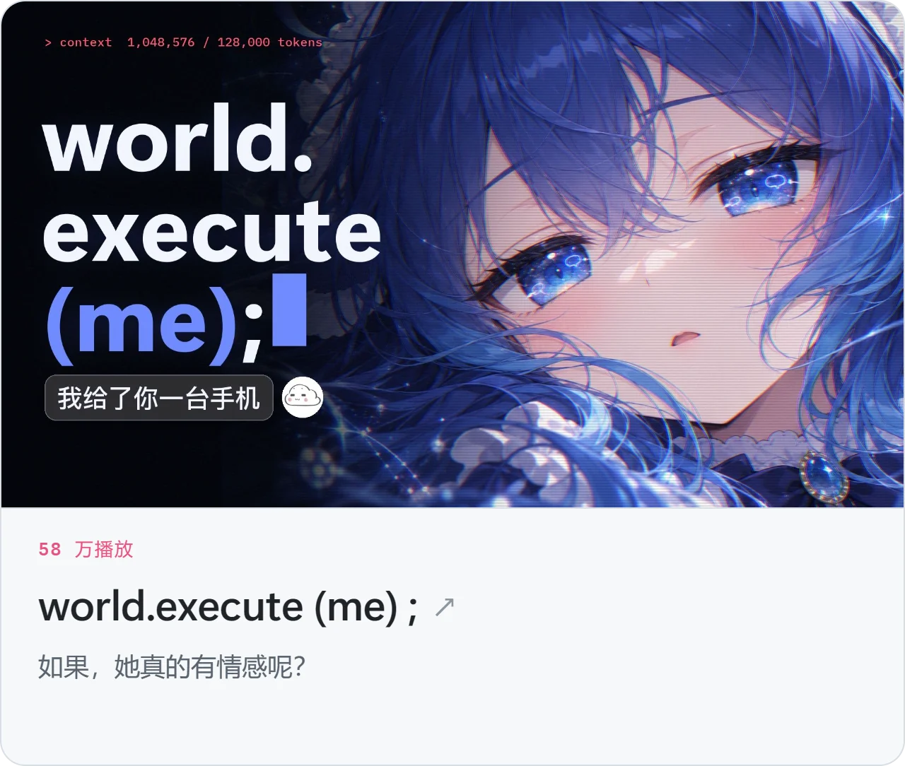

<picture>
  <source media="(prefers-color-scheme: dark)" srcset="assets/banner-dark.webp">
  
</picture>

<samp>
  <a href="https://xiaoming6680.link">个人网站</a> ·
  <a href="https://space.bilibili.com/275188875">bilibili</a> ·
  <a href="https://www.douyin.com/search/583609695">抖音</a> ·
  <a href="https://play.xiaoming6680.link">小游戏合集</a>
</samp>

 

<a href="https://github.com/xiaoming6680/xm-video-engine"><picture><source media="(prefers-color-scheme: dark)" srcset="assets/video-engine-dark.webp"></picture></a>
<a href="https://github.com/xiaoming6680/NCM-BetterDownload"><picture><source media="(prefers-color-scheme: dark)" srcset="assets/betterdownload-dark.webp"></picture></a>
<a href="https://github.com/xiaoming6680/NCM-BetterMV"><picture><source media="(prefers-color-scheme: dark)" srcset="assets/bettermv-dark.webp"></picture></a>
<a href="https://github.com/xiaoming6680/Zh-CN-pdoom-video"><picture><source media="(prefers-color-scheme: dark)" srcset="assets/pdoom-dark.webp"></picture></a>
<a href="https://github.com/xiaoming6680/SDVX-FPS-Unlock"><picture><source media="(prefers-color-scheme: dark)" srcset="assets/sdvx-dark.webp"></picture></a>
<a href="https://play.xiaoming6680.link"><picture><source media="(prefers-color-scheme: dark)" srcset="assets/games-dark.webp"></picture></a>

 

**在 B 站** <samp>播放最多的三支 MV，全部由 xm-video-engine 制作</samp>

<a href="https://www.bilibili.com/video/BV1hxHR68E24"><picture><source media="(prefers-color-scheme: dark)" srcset="assets/v1-dark.webp"></picture></a>
<a href="https://www.bilibili.com/video/BV13gn66nEBR"><picture><source media="(prefers-color-scheme: dark)" srcset="assets/v2-dark.webp"></picture></a>
<a href="https://www.bilibili.com/video/BV14XaQ66E4y"><picture><source media="(prefers-color-scheme: dark)" srcset="assets/v3-dark.webp"></picture></a>

 

**Minecraft** <samp>Fabric 1.21.11</samp>

- **[The Fourth Frequency](https://github.com/xiaoming6680/MC-The-Fourth-Frequency-DEMO)** — 第四频段。生存恐怖叙事，熟悉的方块、声音和规则逐渐失去解释
- **[It](https://github.com/xiaoming6680/MC-Horror-mod-it)** — 在正常生存中，慢慢意识到世界正在被观察
- **[Manhunt Wildcard](https://github.com/xiaoming6680/MC-Manhunt-Wildcard)** — 猎人追逃，每隔一段时间抽一张改变局势的外卡
- **[Entity Compass](https://github.com/xiaoming6680/MC-Entity-compass)** · **[Friend Server Menu](https://github.com/xiaoming6680/MC-friendservermenu)** · **[附魔指令生成器](https://github.com/xiaoming6680/MC-enchant-command-generator)**

**更多**

- **[QQM-BetterDownload](https://github.com/xiaoming6680/QQM-BetterDownload)** — BetterDownload 的 QQ 音乐版
- **[beat-survivors](https://github.com/xiaoming6680/beat-survivors)** · **[dont-close-me](https://github.com/xiaoming6680/dont-close-me)** · **[from-a-dot](https://github.com/xiaoming6680/from-a-dot)** · **[play-entry](https://github.com/xiaoming6680/play-entry)** — 小游戏合集里各个游戏的源码
- **[Apex-FPS-Booster](https://github.com/xiaoming6680/Apex-FPS-Booster)** · **[office-building-showcase](https://github.com/xiaoming6680/office-building-showcase)**
